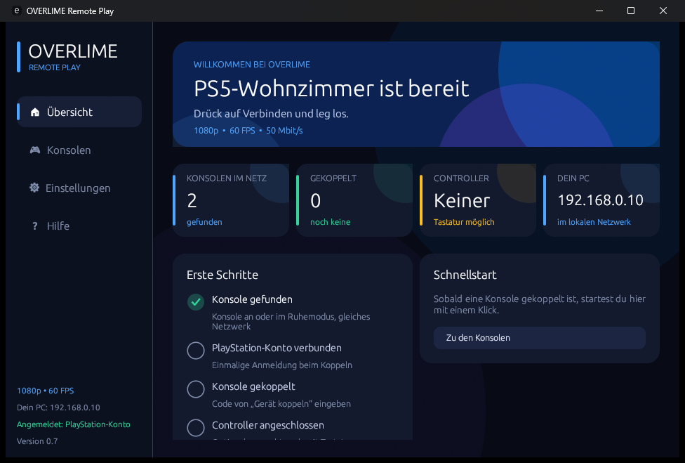
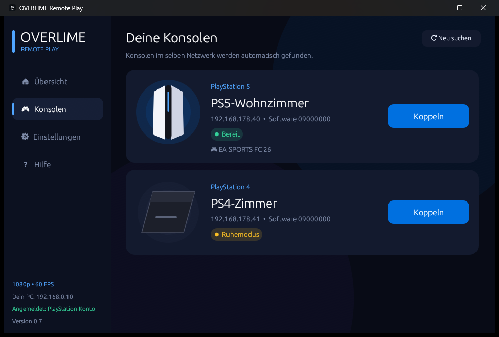
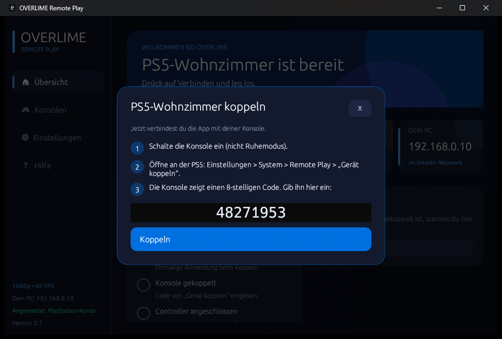
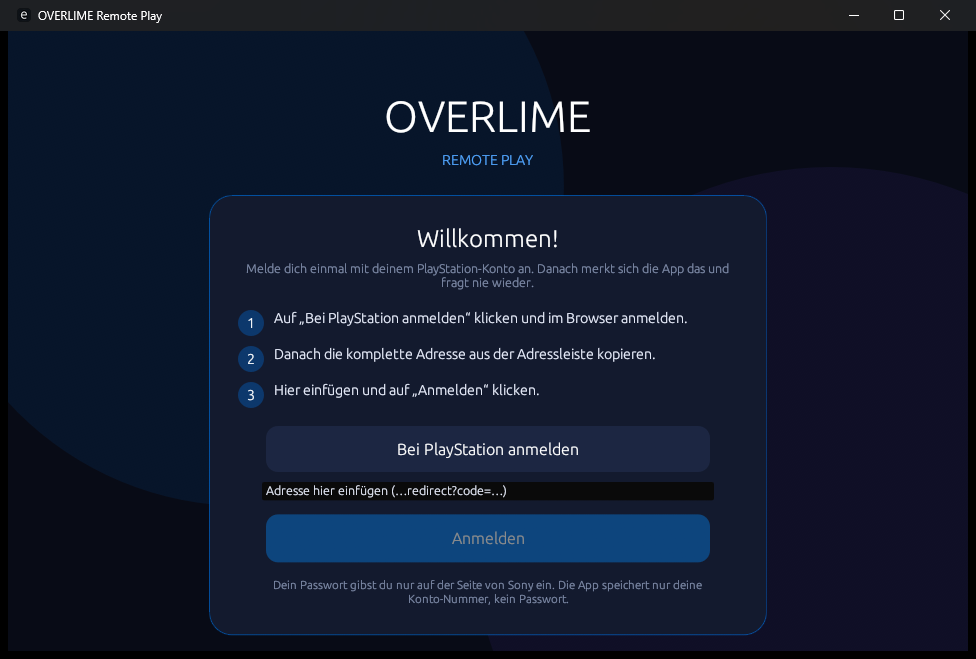
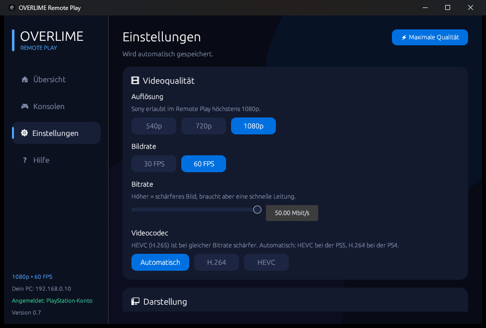

# OVERLIME

### Dein PS4- und PS5-Remote-Play für den PC. Schön, schnell, einfach.

Spiele deine PlayStation-Spiele auf dem Windows-PC, mit bis zu **1080p bei 60 FPS**,
moderner Oberfläche und einem Start in unter einer Minute.

[**Herunterladen**](https://github.com/Overtime09991/overlime/releases/latest) &nbsp;•&nbsp; Windows 10/11 &nbsp;•&nbsp; PS4 & PS5 &nbsp;•&nbsp; kostenlos & Open Source

> **Frühe Testversion.** Oberfläche, Anmeldung und Konsolensuche sind fertig. Das Koppeln und Streamen wird gerade mit echten Konsolen erprobt. Rückmeldungen sind willkommen.

## Warum OVERLIME?

- **Einfach starten.** Einmal bei PlayStation anmelden, Konsole koppeln, spielen. Die App merkt sich alles.
- **Deine Konsole wird automatisch gefunden.** Keine IP-Adressen, keine Einstellungen, kein Fachwissen nötig.
- **Aus dem Ruhemodus aufwecken.** Ein Klick, und die Konsole startet, ohne dass du aufstehen musst.
- **Bestes Bild, das Sony erlaubt.** Bis 1080p60 mit bis zu 50 Mbit/s und HEVC (H.265) wo die Konsole es kann, Hardware-Decoding auf der Grafikkarte für wenig Verzögerung.
- **Controller oder Tastatur.** Xbox-, PlayStation- und andere Controller werden automatisch erkannt. Ohne Controller geht es mit der Tastatur.
- **Ton inklusive.** Spielton direkt auf deinem Standard-Wiedergabegerät.
- **Bleibt aktuell.** Neue Versionen lädt die App selbst, prüft sie und startet neu.

## So sieht es aus

| Deine Konsolen | Einfach koppeln |
| --- | --- |
|  |  |

| Einmal anmelden | Qualität einstellen |
| --- | --- |
|  |  |

## In drei Schritten loslegen

1. **Herunterladen:** `overlime.exe` von der [Release-Seite](https://github.com/Overtime09991/overlime/releases/latest) laden und starten.
2. **Anmelden und koppeln:** Mit dem PlayStation-Konto anmelden (nur einmal), bei der Konsole auf **Koppeln** klicken und den 8-stelligen Code eingeben, den die Konsole unter *Einstellungen › System › Remote Play › Gerät koppeln* anzeigt.
3. **Spielen:** Auf **Verbinden** klicken.

**Vorher an der Konsole:** Remote Play aktivieren (*Einstellungen › System › Remote Play*). Soll die Konsole aus dem Ruhemodus aufwachen, dort „Mit dem Netzwerk verbunden bleiben“ und „Aktivierung über das Netzwerk zulassen“ einschalten.

> Windows zeigt bei neuen Programmen evtl. „Der Computer wurde durch Windows geschützt“. Dann auf *Weitere Informationen › Trotzdem ausführen* klicken. Falls beim Start eine Datei `VCRUNTIME140.dll` fehlt, einmal das [Microsoft Visual C++ Redistributable](https://aka.ms/vs/17/release/vc_redist.x64.exe) installieren.

## Qualität

| Einstellung | Auswahl |
| --- | --- |
| Auflösung | 540p · 720p · 1080p (Sony-Limit) |
| Bildrate | 30 oder 60 FPS |
| Bitrate | 2 bis 50 Mbit/s |
| Codec | Automatisch · H.264 · HEVC |
| Darstellung | Hochskalierung für große Monitore, Vollbild (F11) |

Mit **⚡ Maximale Qualität** stellst du alles auf einmal auf das Beste.
*Tipp für das beste Ergebnis:* Konsole per LAN-Kabel anschließen, PC per Kabel oder 5-GHz-WLAN.

## Steuerung

Controller werden automatisch erkannt. Ohne Controller:

| Taste | Funktion |
| --- | --- |
| W A S D | Linker Stick |
| Pfeiltasten | Steuerkreuz |
| Leertaste / E / Q / R | Kreuz / Kreis / Quadrat / Dreieck |
| Z / X | L1 / R1 |
| Shift / Strg | L2 / R2 |
| Tab / Rücktaste / F2 | Options / Share / PS-Taste |
| F11 / Esc | Vollbild / Stream beenden |

## Datenschutz

- Dein Passwort gibst du **nur auf der Seite von Sony** ein. OVERLIME sieht es nie.
- Gespeichert wird nur deine PlayStation-Konto-Nummer und die Kopplung mit deiner Konsole, lokal auf deinem PC.
- Es gibt keine Werbung, kein Tracking und keine Nutzerkonten bei uns.

## Häufige Fragen

**Warum nur 1080p, nicht 4K?** Die PlayStation sendet über Remote Play höchstens 1080p. Das legt Sony auf der Konsole fest.

**Meine Konsole wird nicht gefunden.** PC und Konsole müssen im selben Netzwerk sein, die Konsole an oder im Ruhemodus mit Netzwerkverbindung. Die Windows-Firewall-Abfrage beim ersten Start mit *Zugriff zulassen* bestätigen.

**Wo finde ich das Protokoll bei Problemen?** In der App unter *Hilfe › Protokoll-Ordner öffnen*.

## Über das Projekt

OVERLIME ist Open Source (AGPL-3.0). Der Stream-Kern basiert auf dem Projekt [chiaki-ng](https://github.com/streetpea/chiaki-ng), dem wir für die großartige Arbeit danken.
OVERLIME ist kein offizielles Produkt von Sony. „PlayStation“ ist eine Marke von Sony Interactive Entertainment.

Entwickler: Hinweise zum Selbstbauen und Veröffentlichen stehen in [BUILDING.md](BUILDING.md).
